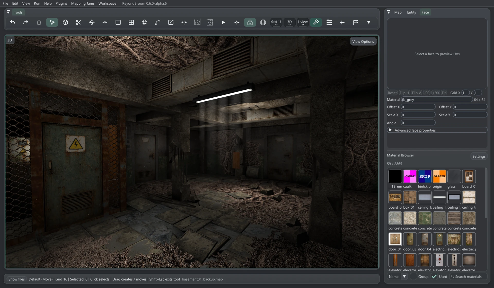

# ReyondBroom

ReyondBroom is an open-source level editor powered by FTE Quake for Windows and Linux. Edit maps for Quake, Quake II, Quake III Arena, Half-Life, and custom FTE games. Build and inspect BSPs, trace leaks in the viewport, and playtest with the runtime configured for your game.

[**Download the latest alpha (0.6.0-alpha.11)**](https://github.com/reyond9079/ReyondBroom/releases/tag/v0.6.0-alpha.11) · [All releases](https://github.com/reyond9079/ReyondBroom/releases) · [Quick start](docs/quick-start.md) · [Documentation](docs/README.md) · [Discord](https://discord.gg/eDMf53Kny)

## Get started

1. Download and extract the **Windows x64**, **Linux x64**, or **Linux SDL2 x64** package.
2. Launch ReyondBroom and choose a [game profile](docs/game-compatibility.md). For Quake 1, you can use LibreQuake or point the editor to your own game or mod.
3. Open a copy of a `.map` file and save it in a writable folder. Use **Compile** and **Show BSP** to check the result, then **Play mod** or your configured engine to test gameplay.

The release page has source archives and SHA-256 checksums. See the [installation guide](docs/quick-start.md#install) for launch commands and [Linux requirements](docs/linux.md) for runtime dependencies.

## What you can do

- **Edit maps.** Work with brushes, entities, materials, and UVs in 2D and 3D. Organize levels with groups and layers, use clipping and CSG, and load custom entity definitions. [Editor manual](docs/manual.md)
- **Compile and test.** Run compiler stages, inspect lightmaps, and follow a leak trail through the map. Import TrenchBroom compilation profiles or configure a Run task for your engine. [Build and launch](docs/compilation-profiles-build.md) · [Leak inspection](docs/leak111.md)
- **Create assets.** Edit meshes and UVs, paint textures, animate models, and generate vegetation with the built-in editors. Export and placement options depend on the game profile. [Model Editor](docs/model-authoring.md) · [Plant Editor](docs/plant-editor.md)
- **Browse mod assets.** Open mod folders and PAK archives and preview models and sounds from the workspace. [Mod file manager](docs/manual.md#mod-file-manager-models-and-sounds)
- **Generate editable geometry.** Use World Architect to generate and refine level layouts and architecture. AutoLevel is available under **Legacy generators**. [World Architect](docs/world-architect.md) · [AutoLevel](docs/autolevel.md)
- **Author FTE materials.** The optional Reyond's GLSL Shader Pack adds water, skies, fog, and weather controls to the **FTE Custom game** profile. [Shader Pack](docs/shader-pack.md)

## Mapping Jams

Join an online jam to create and publish a map on your plot and play maps made by other participants. **Mapping Jams is an unstable alpha. Online progress may be reset in future updates.** [Mapping Jams guide](docs/mapping-jams.md)

## Project links

[Game compatibility](docs/game-compatibility.md) · [Troubleshooting](docs/quick-start.md#troubleshooting) · [Issue tracker](https://github.com/reyond9079/ReyondBroom/issues) · [Architecture](ARCHITECTURE.md) · [Testing](TESTING.md) · [License](LICENSE) · [Third-party notices](THIRD-PARTY.md)
