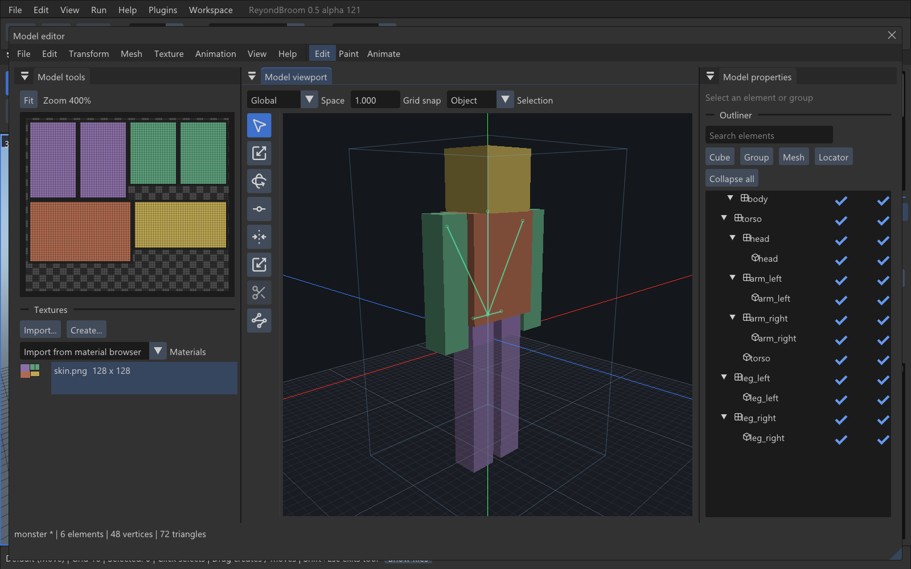
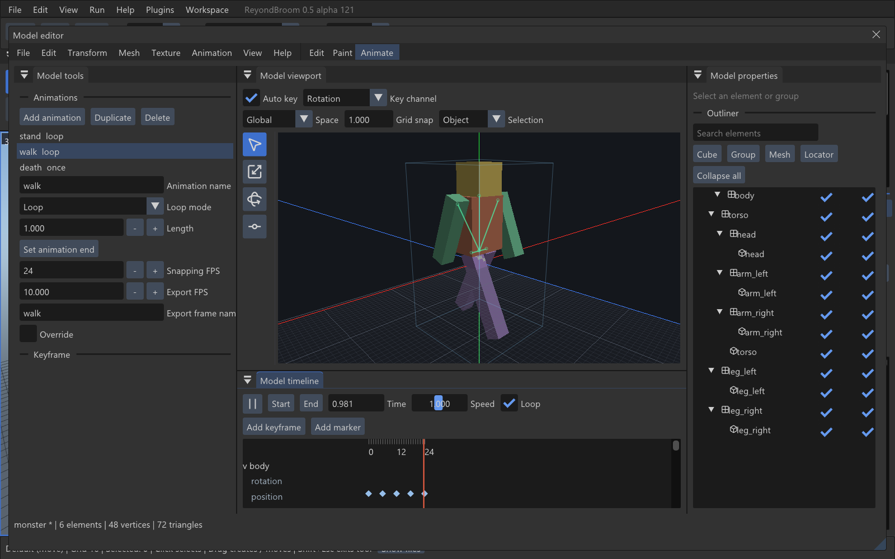
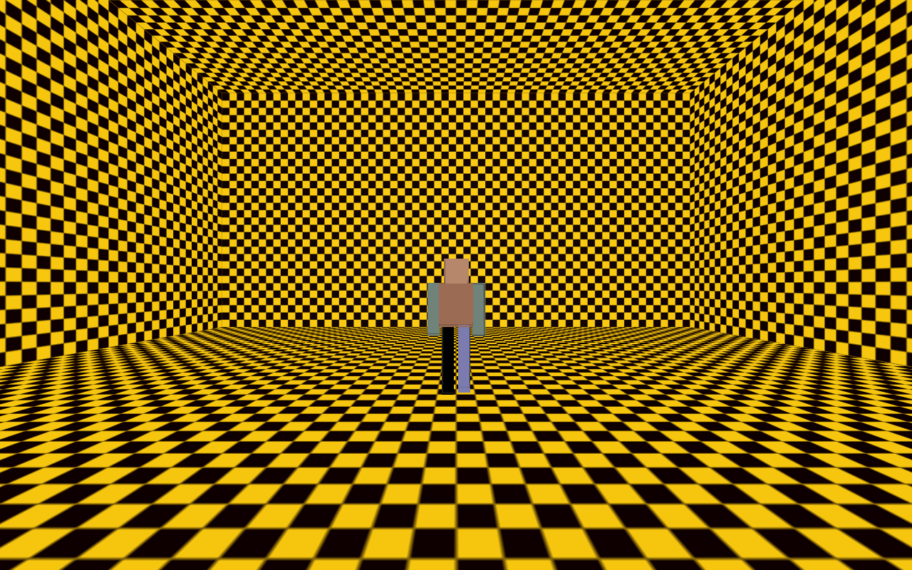

# Model authoring validation — alpha 121

The required first-pass authoring stages are implemented. The optional second
pass (stage 10) is explicitly separated in the [guide](model-authoring.md).
The complete requirement/file/test mapping is in
[model-authoring-coverage.csv](model-authoring-coverage.csv).

## Reference compatibility

Reference: actual Blockbench 5.2.2, Generic codec 5.0, commit
`ec0b2827104d0799c153bfb5f867579c0c44652f`. Original fixtures cover rotated
cubes, mirrored box UV, three nested groups, mixed mesh faces, four animation
interpolations and a legacy 4.0 project.

Geometry and per-corner UVs match actual OBJ exports within 0.0001 units.
Animation checks compare actual reference channel values and 44 sampled glTF
world poses, including Bezier/Catmull-Rom/discontinuous keys. The reference glTF
is exported at 500 Hz to avoid its low-rate close-sample dropping.

A project saved by the native Windows editor was opened in the actual reference
codec: 6 elements, 7 groups, a 128-pixel texture, 3 animations, no JavaScript
errors. Unknown fields remain in the saved JSON. Current and migrated projects,
embedded images and edited texture paths are covered by the IO tests.

## Automated checks

Nine standalone C++ suites pass on Windows and Linux: geometry, IO, animation,
editing, paint, transforms, mixed history, export and mesh topology. They include
50 mixed operations with complete Undo/Redo, Escape cancellation, all eleven
primitives, closed/nondegenerate geometry, palette matching, painted UV texels,
negative OBJ indices and the four populated export templates.
Additional visibility checks cover front/rear points, transparent texels,
spatial-tree traversal, missed bounds and empty geometry on both platforms.

Actual ImGui/engine tests exercise mouse Move/Resize/Rotate/Pivot (one history
record each), geometry-preserving pivots, cursor-aligned UV movement, 2D/3D
strokes and Undo, timeline key dragging, modal windows, dirty-project guards,
autosave, native-model conversion, asynchronous glTF import and renderer restart.
The glTF test checks Y-up bounds and its baked 512-pixel diffuse skin.

The existing native model workflow is separately tested for texture rendering,
wire/textured/untextured views, parent transforms, bones, first-person camera,
WASD flight, five exports/reopening and unchanged original source hashes.
Linux functional runs use both native GL and SDL2 with llvmpipe under Xvfb;
these are not native Wayland/desktop-session certification.

The indexed UI entry point is tested for bad counts/indices, NaN/Infinity,
16/32-bit indices, winding, UV/color preservation and clipping. The fallback
clipper passes 100,000 exact reference-triangle comparisons. Before/after Linux
captures of the model and UI contain no changed pixel exceeding 2/255 per
channel (model region: 476,640 pixels; UI region: 1,050,000 pixels).

All 84 ordered engine patches reproduce the source used to build the engine;
a repeated application changes no files. Recognized older ordered patch stages
can be upgraded; unrecognized local edits are rejected. No user MAP, WAD, model
or mod files are modified by these tests.

## Measured rendering

Windows, NVIDIA RTX 4060 Laptop GPU, driver 591.74, 1600 x 1000 client area,
uncapped frame rate, vsync off. The disposable test window is kept visible and
active: occluded/background Windows GL measurements were much lower and are
excluded from these results. Numbers describe this machine and fixture.

Native in-memory mesh submission (A), updating the buffer every frame:

- 5,000 triangles: **425.8 FPS**, mean CPU upload **0.102 ms**.
- 20,000 triangles: **290.2 FPS**, mean CPU upload **0.500 ms**.

Equivalent per-vertex QC polygon submission (B), with the same color/culling:

- 5,000 triangles: **265.6 FPS**.
- 20,000 triangles: **116.6 FPS**.

The native path is retained: 1.60x / 2.49x the reference FPS at these sizes,
supports material batching/raw images, and avoids temporary model files.
Upload timing is CPU API cost, not end-to-end input latency.

Full Edit UI, selected mesh, visible UV edges/handles, texture and inspector:

- 5,000 triangles: **136.4 FPS**; panel CPU **3.04 ms**, UI submission **1.72 ms**.
- 20,000 triangles: **47.1 FPS**; panel CPU **11.80 ms**, UI submission **5.99 ms**.

The required 60-FPS 5K preview passes. 20K with every UV handle visible is a
heavier case and remains below 60 on this machine. No mesh detail or smoothing
is removed. UV topology/projection constants are cached, 2D batches are larger,
and indexed UI buffers are submitted per material/clip rectangle instead of
converting every triangle into a separate quad call. Updates coalesce at 60 Hz;
texture painting uploads coalesce at 30 Hz.

## Runtime proof

The monster template exports 40 frames (base + 20 stand + 10 walk + 9 attack).
It was placed in an original sealed test room, compiled to BSP2 and run in
standalone FTE without the editor plugin. QuakeC logs show changing walk frames
and fixed origin `(0, 0, 24)`; the bottom of the model rests on the floor.
MDL uses the game palette without fullbright indices. The same animated monster
was also loaded as MD3 with its exported external skin in standalone FTE.
This checks the native MD3 loader, not a complete third-party Quake III mod.

## Deliberate limits

Generic authoring only. Native model import converts its first pose and skin,
preserving the original file; it does not reconstruct an editable source rig.
The bridge bakes diffuse images, not arbitrary PBR shader graphs. Current
writers omit locator tags with a warning. MDL/MD2 use indexed, resampled atlas
skins and quantized vertex positions; warnings describe these losses. Static
IQM/MD5MESH exports do not add a newly authored skeletal rig. Unsupported source
metadata is retained where possible. Optional stage-10 tools and the remaining
differences are listed explicitly in the guide.
