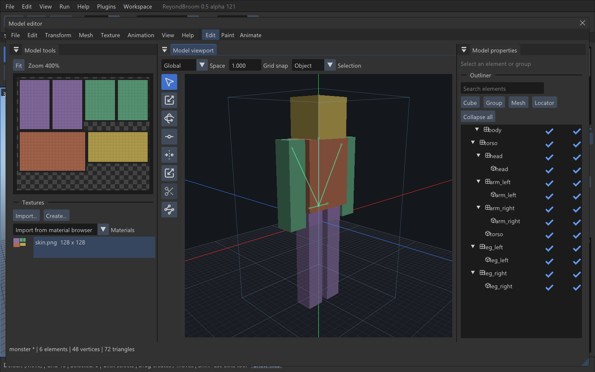
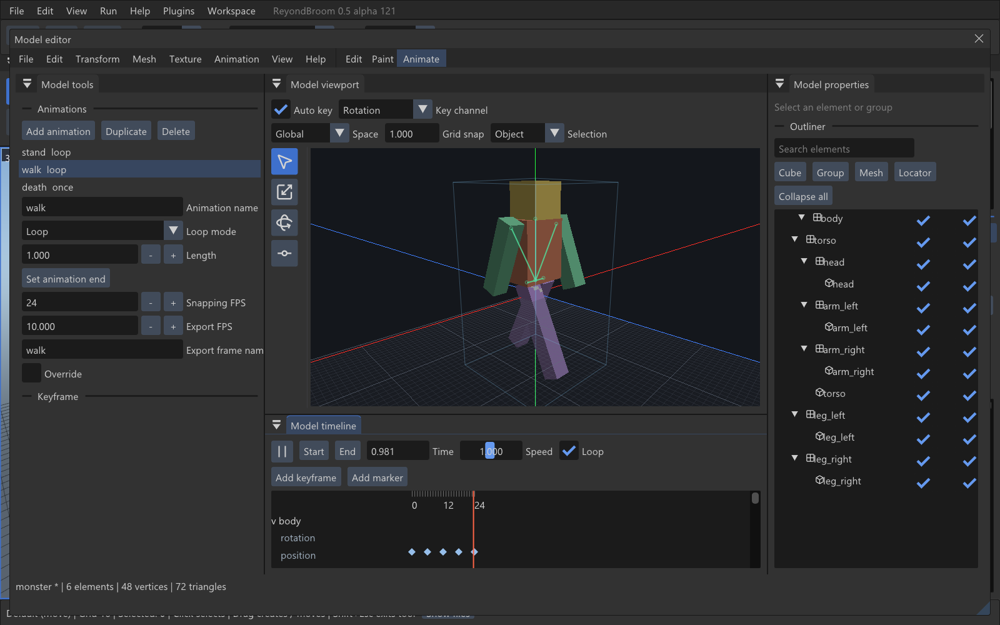

# Model authoring

The Model editor has two workflows. Open a compiled native model to inspect,
transform and export it using the existing editor. Choose **File > Convert to
editable project** to build an editable first-pose project. Choose **File > New
model** in the main editor, or the file manager's New menu, to start authoring.
Double-click a `.bbmodel` file to open it directly.

Authoring projects support cubes, polygon meshes, hierarchical groups, pivots,
UVs, pixel painting and group keyframe animation. They use the Generic `.bbmodel`
5.0 codec. The editor uses its own icons, themes and native ImGui interface.

## A monster in five minutes

1. Choose **File > New model > Quake monster**, give it a name and a destination
   inside the mod. Select Quake MDL as the target. Create a texture template.
2. Select a cube in the Outliner. Use Move, Resize, Rotate and Pivot, or enter
   Position, Size, Pivot and Rotation numerically in Model properties.
3. Open Paint. Choose a color and paint directly on the model, or turn on **2D**
   to paint its texture. Quake 1 painting can snap to the game's palette.
4. Open Animate. Select `walk` and press the triangle Play button. Select a group,
   position the playhead and rotate it with Auto key enabled to add a key.
5. Save the `.bbmodel`, then **File > Export**. Review the format warnings and
   frame ranges, choose a new model filename, then use **Place in map**.

The supplied monster has stand, walk and death clips: base frame plus 20 stand,
10 walk and 9 death frames, 40 in total. The weapon template has eight frames.
Item and prop templates are also available. The template atlas grows to a power
of two when the requested texel density cannot fit a smaller image.

## Windows, camera and selection

The tools/UV panel is on the left, properties and Outliner on the right, and the
viewport in the centre. Animate adds a bottom timeline. These panels dock and
resize independently. **View > Reset layout** restores the default arrangement.
The editor uses the application's theme and font size.

Hover the viewport to fly with WASD/QX; hold RMB to look. MMB pans, the wheel
zooms. Shift accelerates and Alt slows the camera. Numpad 1/3/7 selects front,
right/top orthographic views; Ctrl chooses the opposite side. Numpad 5 toggles
orthographic projection. `.` focuses the selection. Save named camera views in
View. View-from-player starts enabled for projects named `v_*`.

The document is Y-up. North faces negative Z. The export basis maps project
`(x,y,z)` to Quake `(-z,-x,y)` by default; one unit stays one unit. Project settings
control export scale and front direction. The inspector can display Quake axes.
Grid and origin axes, a player-size silhouette, bones, culling, solid/textured,
wireframe and a UV checker are independently selectable in View.

Click selects, Shift adds/removes in the viewport and selects a visible range in the Outliner. Ctrl-drag makes a selection rectangle. Choose
Object, Face, Edge or Vertex above the viewport; edges and vertices belong to
meshes, so convert a cube to mesh before editing its topology. Alt-click an edge
selects its quad loop. Select All and Invert respect the active selection mode.
Double-click an element in the viewport to select its parent group; double-click an Outliner name to rename it.

## Edit

- **Move:** axis arrows and plane handles; Global, Local and Parent spaces.
- **Resize:** six cube-side handles, or mesh scaling. Crossing an opposite cube
  face normalizes its bounds. Enter exact cube dimensions in properties.
- **Rotate:** drag the rings or enter XYZ Euler angles. Rotation snap is separate
  from the movement grid.
- **Pivot:** move the object's or group's pivot while preserving its resting
  geometry. Group animation rotates around that pivot.
- **Vertex Snap:** choose Move or Scale; first click a source vertex on selected
  geometry, then a destination vertex.
- **Stretch:** adjusts cube stretch; mesh transforms work on selected components.
- **Seam:** click mesh edges to mark UV divisions or joins; Unwrap uses these.

The Outliner supports nested groups, renaming, Collapse all, marker colors, sorting, resolving groups,
duplicating, deleting, search, visibility, lock and export flags. Drag nodes to
reparent; Alt-drag duplicates before reparenting. Rest geometry remains in place.
Reparenting an animated rig retains its local key values; its animated axes can
therefore change. Locked ancestors prevent picking and transformations.

Add Cube, Group, Mesh or Locator from the Outliner or Transform menu. Cube
properties include from/size, origin, rotation, inflate, stretch, box/mirror UV,
shading, marker color and Auto UV (Off/On/Relative). Transform also offers axis
quarter-turns, flips, centering, individual pivots, hide/unhide and export flags.

Mesh primitives: cuboid, beveled cuboid, pyramid, plane, circle, cylinder, tube,
cone, sphere, icosphere and torus. The primitive dialog controls size, height,
sides, minor diameter and edge alignment where applicable. Caps are triangulated
so every editable face has three or four vertices.

Mesh operations: Convert to Mesh, Extrude, Inset, Loop Cut, Create Face, Invert
Face, Merge by distance/to centre/to last, Split, Dissolve Edges, Apply Rotation,
Solidify and deletion of selected faces/edges/vertices. Loop Cut slices with a
local plane; it is not a full topology-following edge-strip tool. Dissolve joins
two coplanar triangles into a quad. Unwrap deterministically unfolds along
non-seam hinges; it is not an LSCM/ABF solver.

## UVs and textures

Choose a texture and face. Cubes have N/E/S/W/U/D buttons, rectangle coordinates,
rotation and enable controls. Box UV has an atlas offset. Meshes expose UV
position and size, editable corner vertices, Shift multiselection and Ctrl-drag
UV selection. Drag an island or its vertices; movement snaps to image pixels.
Hold Shift for unsnapped adjustment. MMB pans; wheel zoom anchors to the cursor
and does not scroll the surrounding panel. Fit frames the image.

Texture menu: Maximize, Auto/Relative UV, Project from View, Mirror X/Y, Rotate
Left/Right, Turn Mapping, Reset, Apply to All Faces, Transparent, pixel snap,
Merge UV vertices, Connect UV faces, Unwrap and Cycle. Rotation is 90 degrees;
Cycle changes the vertex-to-UV association. Seams and marker colors help
identify islands. UV-check display uses an actual checker texture.

Import images, WAD/WAL/LMP images through the existing image decoder, or import
an image from the material browser. Drag a project texture onto an element or
the viewport to assign it. Create texture template packs padded cube faces or
mesh islands in a power-of-two atlas. Control resolution per 16 units, box UV,
compression, outlines and fill (marker, transparent or custom). A blank texture
can also be created. Source texture layers are opened as their flattened bitmap;
layer metadata is retained, without a layer editor.

Texture context menu: Save as PNG/TGA, Refresh, Delete, Resize with optional UV
rescale, flip, rotate, invert, brightness/contrast/hue/saturation/opacity,
clear unused pixels, limit to palette and use as default. Save as updates the
refresh source. Projects embed PNG images by default, so they remain portable.

## Paint

Brush, Eraser, Fill, Color Picker, Draw Shape, Gradient, Copy Brush and Selection
work in the texture canvas and on the 3D surface. A 3D stroke is clipped to its
starting surface's UV region. Fill supports face, element, color and connected
color, with tolerance. Brush options: 1–50-pixel size, opacity, softness, square
or circle, alpha lock, pixel perfect, X mirror and selected-elements-only.

Blend modes: Default, Set opacity, Color, Behind, Multiply, Add, Screen and
Difference. Alt picks a color; Shift connects the previous stroke with a line.
Copy Brush uses Ctrl-click to choose its source. Shape supports rectangle or
ellipse, filled or outline. Selection supports moving pixels, copy/cut/paste,
delete and crop. Each stroke is one Undo step; Escape cancels it.

The palette supports add/remove, generation from the texture, sort and
GPL/HEX/LMP import/export. The Quake palette labels fullbright colors separately.
Palette-limited Quake 1 painting and MDL export use the same exact RGB-distance
search over indices 0–223; exported opaque skins do not introduce fullbrights.

## Animate

Groups are bones. Their position, rotation and scale have independent keyframe
channels. Select an animation, set Length, Loop (Once/Loop/Hold), snapping FPS,
export FPS, export frame prefix and Override. Use Auto key while manipulating a
group, or Add keyframe. The inspector offers key time/value, interpolation,
channel, separate before/after values and linked/unlinked Bezier handles.

Timeline: Play/Pause, speed, loop preview, start/end, seconds and frame marks,
playhead scrubbing, collapsed group/channel rows, key selection and box
selection, Shift add/remove, dragging and Ctrl-drag duplication. Ctrl-wheel
zooms and the scrollbar pans. Markers jump to marked positions. Home/End and
left/right frame stepping work in the timeline context. A drag creates one Undo
record. Escape restores the pre-drag document.

Animation actions include key reset, reverse, rounding, optimize, speed change,
merge by appending, pose copy/paste and bake current pose to static geometry.
Linear, Catmull-Rom, Bezier and Step interpolation are tested against actual
reference exports, including discontinuous keys. Unsupported Molang text is
retained but evaluated as zero with a warning.

## Export, import and map placement

Save the authoring project before exporting. Export writes a new native model
and, when needed, an adjacent skin directory/MTL. Existing destination models or
companion files are rejected instead of silently overwritten. Export does not
change the project. The adjacent `.reyond.json` records bounds and frame names
for correct floor placement; retain it when copying the model.

- **Quake MDL:** baked vertex animation and embedded palette skin. Up to 2048
  vertices, 4096 triangles, 16 materials and 1024 frames in this writer. Surface
  images are baked into padded atlas tiles. Positions have 8-bit precision across
  the complete animation range; the dialog estimates base-pose precision.
- **MD2:** baked vertex animation and a PCX skin; 8-bit position precision.
- **MD3:** baked vertex animation, TGA skins, 1/64-unit position precision and
  coordinates −512 to 511.984. Writer limit: 4096 vertices/8192 triangles per
  surface. The original Q3 vertex limit is lower; the dialog warns about it.
- **GoldSrc MDL:** baked motion tracks and embedded indexed textures; the
  project's group rig is not exported as an editable GoldSrc skeleton.
- **OBJ/MTL, IQM and MD5MESH:** one static pose through the existing writers.
  Locator objects remain in the project; current native writers omit tags and
  warn on export. No format is silently reduced to fit its limits.

Animation export lists exact frame ranges and can copy `$frame` names. Disable
individual clips or the base frame in export/project settings. Frames are sampled
at each clip's export FPS. Runtime AI and QuakeC frame functions still belong to
the game; the authoring editor does not invent monster behavior.

**Place in map** creates the profile's model entity in one map Undo transaction.
Bounds align the exported model with the picked surface. Authoring models marked
by the editor are staged, with external skins, into disposable build/preview
copies. Quake 1 uses FTE's native static-model fallback where ordinary progs lack
a `func_model` spawn function. A mod can supply its own animation/logic classes.

Native MDL/MD2/MD3/other engine-supported models convert their first pose and skin
to a new editable project. Original files and vertex-animation data are unchanged.
OBJ imports directly, including negative indices, per-corner UVs and MTL images. Normals are rebuilt for editable geometry; source rigs and weights remain in the original model.
glTF/GLB/FBX and the existing bridge formats use the automatically managed Blender
runtime; no separate user installation is needed. glTF Y-up orientation is
normalized into project space. The bridge bakes diffuse textures into its working atlas (512 pixels by default). Missing images produce an explicit placeholder.

## History, storage and limits

Ctrl+Z/Y uses a model-only history: affected JSON objects and changed image
rectangles, capped at 128 steps / 256 MiB by default. Map history is separate.
Model settings include grid/rotation/animation snap, default cube size, palette behavior,
autosave interval, embedding, pixel grid and brush outline. Settings are stored
in `data/model-editor-settings.json`. Dirty projects autosave every two minutes
to `data/model-autosave`. Closing or replacing a dirty project offers
Save/Discard/Cancel, including when opening another map.

Input validation rejects malformed JSON, missing/duplicate UUIDs, invalid mesh
indices and non-finite/excessive coordinates before replacing the current project.
Budgets: 4096 elements, 512 groups, 64 textures, 256 animations, 65536 vertices per
mesh, 2048-pixel texture dimensions, 256 MiB decoded images and 128 MiB project
input. Large dynamic previews split into material batches; they do not write a
model file on every edit. Raw image uploads are throttled while painting.
Hidden vertex handles are rejected using an accelerated visibility tree; opaque
surfaces occlude them and transparent texels do not. Visibility is cached until
the camera, geometry or texture pixels change. Bone guides remain visible on top.

## Shortcuts

V Move; T/S Resize; R Rotate; P Pivot; N/X Vertex Snap; 1/2/3/4 selection mode;
Ctrl+1/2/3 Edit/Paint/Animate; E Extrude (Eraser in Paint); I Inset (Picker in
Paint); F Create Face (Fill in Paint); G Fill; M Merge (Selection in Paint);
Ctrl+D Duplicate; Ctrl+C/X/V Copy/Cut/Paste; Delete/Backspace delete; Ctrl+S Save;
Ctrl+Shift+S Save as; Ctrl+Z/Y history; Space animation playback; `.` focus.
The application's shortcut editor isolates these bindings from map shortcuts.

## Compatibility and scope

Real codec 5.0 fixtures, including a migrated 4.0 file, are included under
`tests/fixtures/bb`. Geometry/UVs are compared with actual OBJ exports; animation
poses with actual glTF exports. Unknown fields/nodes remain in the JSON document.
The upper/lower box-UV layout and cube winding follow the tested codec rather
than the inaccurate diagram/order in the original design notes.

Only Generic Model authoring is implemented. Other formats open as Generic while
retaining their metadata. Minecraft Display/CEM, Molang controllers/effects, IK,
weights and unsupported nodes are retained where possible without editing.
Optional follow-up tools are not implemented: Knife, proportional editing,
modeling mirrors, graph editor, texture layers, rigged IQM and native GoldSrc
bone authoring. Knife is visibly unavailable. These are separate from the
completed first-pass authoring workflow.

See [validation and measured performance](model-authoring-validation.md) and
[the native transform workflow](model-editor.md).
