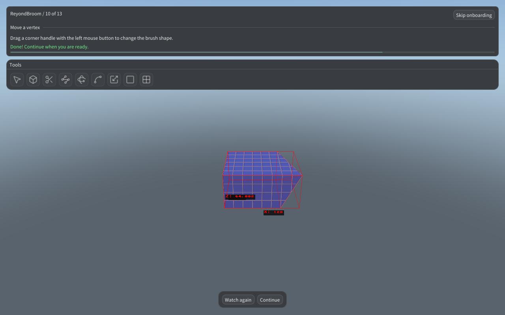
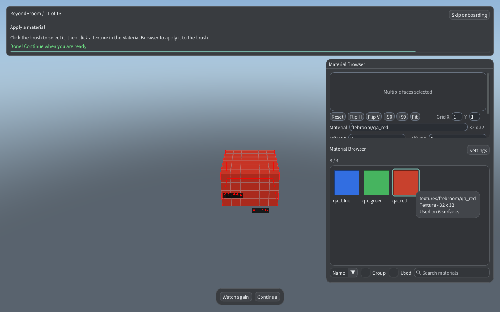
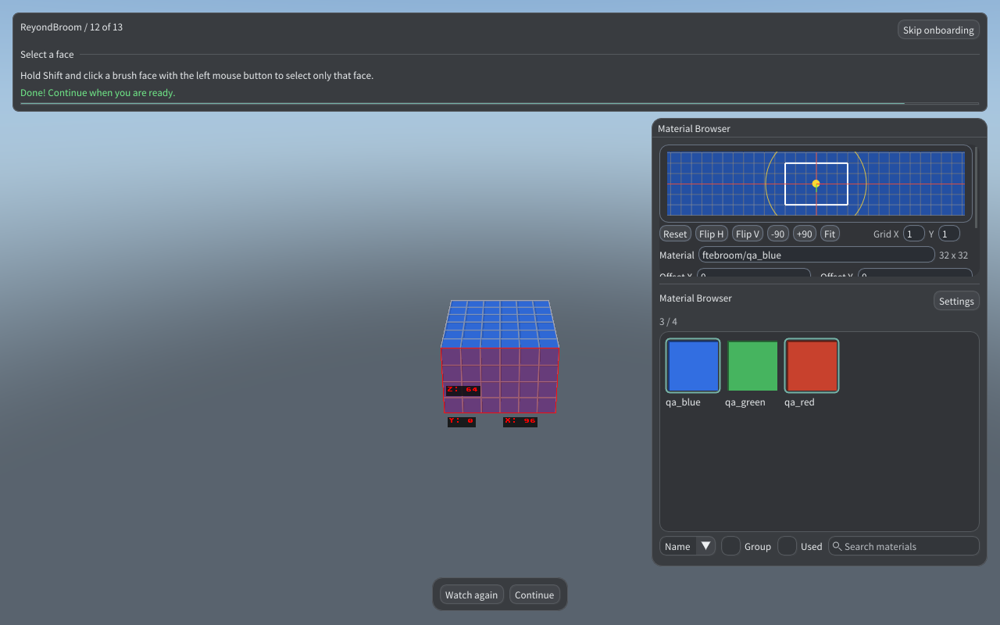

# Onboarding and BSP preview acceptance

The lesson now has 13 stages. Clip uses two separated screen targets across
the top face. Vertex selection is a separate required toolbar step, followed
by a real deformation demonstration and a practice move. The material lesson
uses the editor's Material Browser and bundled textures, followed by a separate
Shift-click face selection lesson. Every stage reloads its disposable map.

The RMB context query is read-only and preserves compiled BSP preview. Actual
editing commands and Escape retain their existing return-to-editor behavior.

## Focused validation

- `scripts/test-editor133-input.py`: real OS brush, Clip, Vertex, material and
  face input, negative completion cases, fixture restoration and saved layout.
- `scripts/test-tutorial-linux.sh`: journal restoration, repeated preparation
  and the exact fixture/selection count on all 13 stages.
- `scripts/test-bsp-preview-input.py`: a real q3map2 BSP, OS RMB press/release,
  native relative-motion events through the existing guarded test bridge,
  and OS Escape. Passed on Linux and Linux SDL2. XTest's synthetic XI2 device
  cannot represent physical relative input, so that part uses the native
  bridge explicitly rather than treating cursor warps as camera rotation.
- `tests/test-welcome-updater.py`: check, session isolation, installation,
  parent waiting and explicit restart protocols.
- `scripts/test-rb10-welcome.py --require-splash`: artwork dimensions and
  persistence during a deliberately pending check, download, verification
  and restart, plus existing recovery and exit guards.
- `tests/ci-policy.py`: 35 policy tests, including exact guarded host edits and
  conservative fallback when ordinary dispatch changes.

The selected CI suites are `ci_unit`, `onboarding`, `updater` and `viewport`.
The generator suites, full atlas and theme/size matrix are excluded.
Local native/QC build hashes and results are recorded in the adjacent JSON
files. Screenshots show the modified local build based on the alpha.154 SDK;
the SDK's title/version is not a newly published release.

## Remaining release dependency

The original user-supplied painting must be added as
`runtime/ui/update-splash.png` before merge and release. The image was visible
in chat but its bytes were unavailable in the workspace. The updater lifecycle
was validated with a clearly labelled synthetic portrait in disposable test
runtimes. That fixture is not a distribution asset.

After the original is available, repeat the splash check with it, package the
next version and run the mandatory Windows/Linux/Linux SDL2 release gates.

## Screenshots

