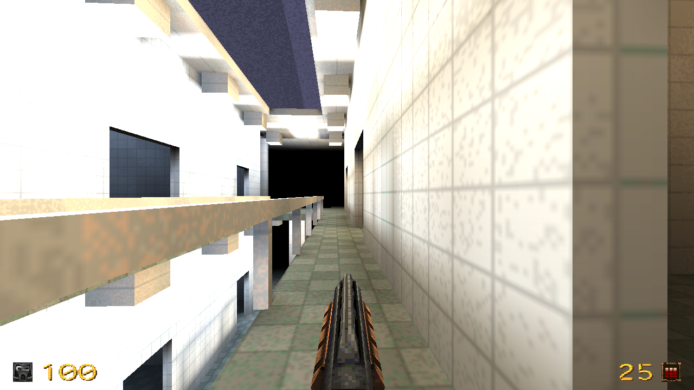
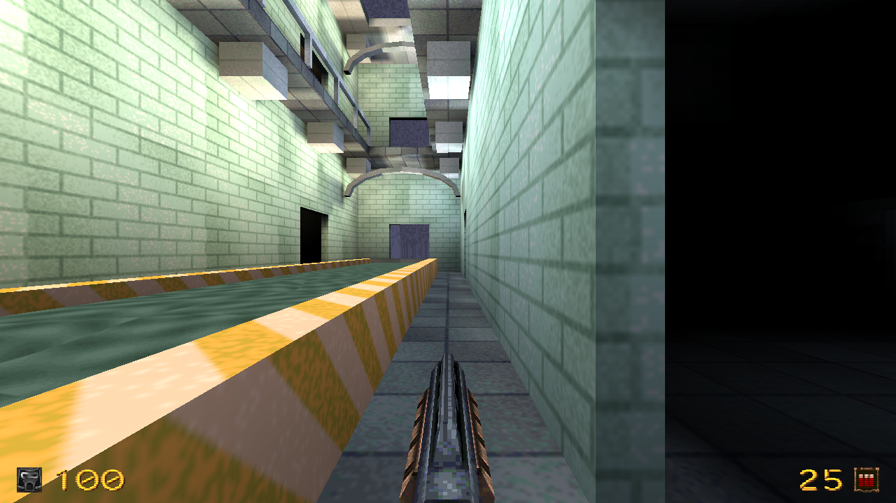
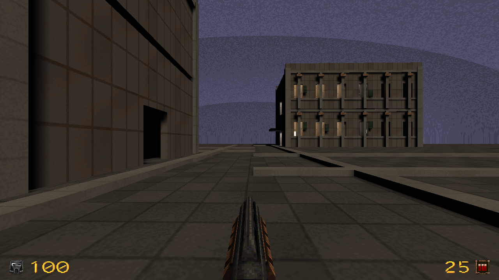
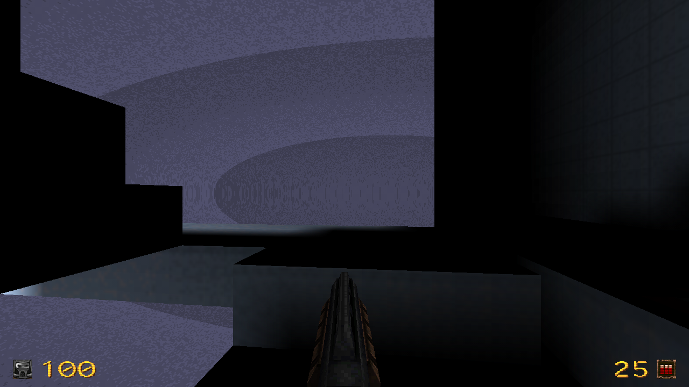

# World Architect acceptance evidence

This report supplements the [user guide](world-architect.md) and [RB-7 specification](specs/RB-7-world-architect-spec.md). Production geometry and navigation were frozen at `049be4c`; the subsequent promotion changes menu placement, window labels and documentation. Merge and release acceptance are recorded separately in PR45.

## Final generation and compiler corpus

The final post-repair corpus accepted **2400 batches / 9600 candidate attempts**: 100 deterministic seeds for each of eight presets under Quake 1, Quake III and FTE. There were **63 rejected candidates (0.66%)**, with structured rejection reasons retained in the QA logs, and **no empty batch**. Each format compiled and lit all eight representative outputs: **24 real compiler pipelines**. Quake 1 water leaves and Q3/FTE water shaders were inspected.

Every preset produced 100 distinct room/architecture fingerprints. Urban presets also produced 100 distinct massing and road fingerprints; hospital, metro and mall intentionally retain their scenario envelope while varying interiors. Mission fingerprints vary across 80–92 of the 100 seeds, depending on preset. These measurements describe structural changes, not texture-only differences.

The full pipeline took 1312.93 seconds, including fixture compilation, deterministic replay, validation and all representative BSP/light builds. Peak process-tree RSS was 741456 KiB and includes compilers. These are measurements from this Linux development container, not a universal performance promise. Quake 1 sample results:

| Preset | Brush range | Mean MAP MiB | Mean generation ms | Sample BSP/light s |
| --- | ---: | ---: | ---: | ---: |
| checkpoint | 791–1137 | 1.36 | 135.2 | 2.66 |
| courtyard | 771–1110 | 1.28 | 117.0 | 1.34 |
| evacuation | 722–1164 | 1.20 | 97.7 | 1.76 |
| factory | 982–1256 | 1.49 | 127.8 | 3.52 |
| hospital | 965–1089 | 1.30 | 98.7 | 1.59 |
| mall | 669–748 | 0.91 | 65.4 | 1.00 |
| metro | 496–556 | 0.67 | 49.1 | 0.57 |
| overpass | 789–1222 | 1.32 | 116.8 | 1.39 |

[Machine-readable measurements and capture provenance](world-architect-acceptance/measurements.json) include the other formats and detailed distributions. The pipeline uses asynchronous stages, cancellation, bounded candidate search and input-aware prefix caching.

## Real editor and game checks

410 core contracts passed. Actual SDL editor checks include all eight presets applied as editable owned geometry and undone in one transaction (25 checks), six scenario previews and candidate comparisons (20), modes/counts/patterns/volumes (20), road sketch/curve/room furnishing/field editing (9), and stair-light export/Apply/Undo (8). Earlier focused runs also cover regional replacement, pins, migration, authored modules, physical gates and save/reopen; their checkpoint details remain in the engineering journal.

A seven-face rubble brush was rejected by the editor despite compiler acceptance: a bevel passed 0.027 units from a corner, below engine clipping/merge tolerances. Construction now keeps a robust corner margin. The original and corrected brushes were imported independently, and every preset subsequently passed real Apply/Undo. The shared editor geometry validator was not weakened.

Actual Ironwail 0.8.2 OS-input walkthroughs completed all 108 hospital and 60 metro waypoints without teleport or noclip. Checkpoint and city evidence initially remained partial: the automated controller stopped short of a stair landing or a waypoint threshold. Those attempts are not represented as complete route passes. The entire required route still passes independent collision/support/hull validation; further game evidence is recorded separately if completed. Controlled physical-door checks confirm blocked-before-activation and passage-after-activation. Their setup used setpos, then explicitly disabled noclip before collision tests.

The user reviewed real hospital, metro and city captures inline and replied **«Принимаю текущий стиль»** on 2026-11-12. This records visual-style acceptance; it does not claim a complete human walkthrough. Captures preserve game pixels; only blank desktop margins were removed. Hospital highlights remain bright in the demonstrated style.

Actual editor examples: [checkpoint](world-architect-acceptance/editor-checkpoint.png), [factory](world-architect-acceptance/editor-factory.png), [courtyard](world-architect-acceptance/editor-courtyard.png), [overpass](world-architect-acceptance/editor-overpass.png), [mall](world-architect-acceptance/editor-mall.png), [evacuation](world-architect-acceptance/editor-evacuation.png).

## Compatibility, preservation and limits

Generation, actual MAP compilation and editor roundtrip are verified for Quake 1, Quake III and FTE Custom. Quake II/GoldSrc compiler/play certification is unavailable and is not promised. FTE uses semantic gates by default unless standard entities are explicitly selected. Required vertical volumes constrain existing circulation; they do not magically carve arbitrary new stairs. No-generation volumes reject occupied architecture while retaining shared ground/sealing geometry. Exact legacy WFC solver semantics remain accessible through Legacy generators and are reported as unsupported by conversion rather than silently reinterpreted.

Original procedural materials/props require no paid asset download. Their GPL notices and the reused MIT convex-kernel notices are retained. Export bundles contain required generated textures/WAD/shaders; copyrighted game PAKs used for private game testing are not distributed. Assets have versioned identities and differing existing files are not overwritten. Existing maps, legacy settings and authored modules remain intact. No Qt was added.

Final platform acceptance includes focused Windows/Linux/Linux SDL2 source checks and, for the published version, mandatory packaged startup/version/archive/source/checksum gates on all three platforms. After promotion, the rebuilt SDL editor passed 26 workspace/Apply/history/save checks. Actual OS clicks reopened World Architect through its primary entry and AutoLevel through Legacy generators. [Primary menu](world-architect-acceptance/plugins-menu.png), [legacy submenu](world-architect-acceptance/legacy-menu.png), [legacy workspace](world-architect-acceptance/legacy-workspace.png). Thirty-one CI policy contracts passed. A source test-driver failure is distinguished from a product failure; prepared binary reuse verifies matching native, QC, engine and build recipe inputs before running corrected OS input.
